#  Changelog

Todas as mudanças relevantes de **Ferramentas agrupadas** ficam neste arquivo. O formato segue o [Keep a Changelog](https://keepachangelog.com/pt-BR/1.1.0/) e a numeração segue o [Versionamento Semântico](https://semver.org/lang/pt-BR/).

> [!NOTE]
> O repositório não tem nenhuma tag git e o `package.json` está em `0.0.4`. As versões 0.0.2, 0.0.3 e 0.0.4 existem só como arquivos `.vsix` locais (ignorados no git); as datas e o conteúdo delas vêm da inspeção desses arquivos. As datas vêm da data de modificação dos arquivos: só o dia 08/10/2026 é confiável, não a ordem entre as três versões (os arquivos internos da 0.0.2 são mais recentes que os da 0.0.4). Onde o git não mostra a informação, o texto diz "sem registro".

> [!WARNING]
> Pendência conhecida, NÃO verificada: pelo conhecimento do `vsce` (não foi executado), ele recusa SVG no README e no changelog, exceto de provedores de badge confiáveis. Este arquivo e o README usam SVG locais, então o primeiro `vsce package` pode falhar. Detalhes na seção de instalação como VSIX do [README](README.md).

| Ícone | Tipo de mudança |
|---|---|
|  | Adicionado |
|  | Alterado |
|  | Corrigido |
|  | Segurança |
|  | Removido |
|  | Testes |
|  | Empacotamento e build |
|  | Documentação |

##  Evolução em números

Medido com `git show` em cada um dos 29 commits sem merges: contagem de linhas que começam por `test(` em `test/*.test.js` e `wc -l` de `src/`, `extension.js` (raiz, até 24/10), `media/` (view.html, view.css, view.js, model, sync, svg-safe, pin-catalog) e `scripts/`, sem arquivos gerados. O histórico tem 33 commits no total, contando 4 merges.

---

##  Não lançado

> [!IMPORTANT]
> **Proposta de próxima versão: 0.1.0.** O redesenho completo do painel muda a interface, o modelo de dados e a superfície de segurança, o que justifica subir a versão menor. A decisão e a tag são do mantenedor; nada disso foi publicado.

###  Redesenho completo do painel (31/10/2026)

####  Adicionado

| O que | Commit |
|---|---|
| Interface redesenhada: modo **Organizar** com arrastar e soltar, teclado (Espaço, setas, Esc), menu ⋯ com Mover para, Renomear, Cor e ícone, Excluir; seletor de ícones | `e149358` |
| Catálogo completo do Lucide (`media/icons.js`, 2015 ícones na versão 1.66.0), com `scripts/build-icons.js` | `dbd740b` |
| **Grupos fixados** na barra de atividades e na barra de status: 40 contêineres fixáveis, `media/pin-catalog.js`, `scripts/build-pins.js`, `src/pins.js`, card nativo com as extensões | `fda3498` |
| Contrato de dados com `id` e cor por grupo (`color`) | `fda3498` |
| Menu de fixar com o texto "barra de atividades e barra de status" | `8fedf06` |
| Ícone da extensão passa a ser o conjunto de blocos do protótipo (gerado); aviso único de primeira ativação que abre o painel | `dcd0961` |
| Bandeja **Não agrupadas** sempre visível, com os ícones originais das extensões (sanitizados), uma linha por extensão e a opção "Lembrar de ocultar o ícone ao adicionar" | `2fcc506` |
| Grupos padrão temáticos (Claude, Git, bancos de dados, contêineres e outros), depois substituídos, ver Alterado | `bae5b3f` |

####  Alterado

- **Grupo padrão único.** Os grupos temáticos deram lugar a um só, **Qualidade e testes** (cor Verde, classe `g-7`), e o cartão de primeira vez sugere esse mesmo grupo (`34b4923`).
- **Interface do painel.** O formulário "Personalizar grupos" do rodapé foi substituído pelo modo Organizar sobre a mesma lista (`e149358`). Sem registro de captura da interface anterior neste repositório além do código.
- **Modo somente leitura removido do painel**, por ser código morto, e o estado de sincronização foi extraído para `media/sync.js` (`829e719`).
- **Contrato de exportação.** `ID_PATTERN` e os limites passaram a ser exportados por `src/config.js` para o teste de consistência (`f0f3cd5`).

####  Corrigido

- Exportação e catálogo do modelo, e layout em largura estreita (`b89e38c`).
- Recolhimento restaurado no ícone principal Ferramentas; condição de corrida em `restoreFold` (`9b35eca`, `10da701`).
- Seleção por teclado cancelável, ícones recentes, limites no cliente e contraste (`829e719`).

####  Segurança

| Commit | IDs | Resumo |
|---|---|---|
| `9b35eca` | SEC-1, SEC-2, SEC-3, SEC-6 | Portões de confiança e de aprovação; validação harmonizada |
| `829e719` | SEC-1 (tooltip) | Ajuste no tooltip, registrado no commit apenas como "SEC-1 tooltip" |
| `389cc5d` | SEC-4 | Lista permitida de tags e atributos SVG no gerador (`scripts/svg-allowlist.js` usada por `scripts/build-icons.js`); o commit é de testes e também traz `test/hardening.test.js` |
| `10da701` | SEC-7 a SEC-12 | Modal com texto escapado completo, ações seguras explícitas, chaves com hash, limite de argumentos, aviso de configuração inválida |
| `3acbc79` | sem ID no commit | Colapso de espaços repetidos, ações que gravam em `settings.json` fora da lista segura, escapes entre chaves, migração de estado |
| `ddd7198` | SEC-17, SEC-18 | Colapso de qualquer espaço Unicode; o limite de favoritos mantém os mais novos |
| `908ada1` | SEC-19 a SEC-22 | Leitura linear de SVG, nomes limpos, realpath, manifestos malformados não quebram o refresh |
| `1f5b428` | SEC-23, SEC-24, SEC-25 | Escapes em `hideName`, falha fechada sem `realpathSync`, limite de corpo no webview |

Resultado atual dessas regras: confirmação modal para itens do projeto com argumentos, aprovações guardadas como SHA-256, limites de 500 favoritos e 200 aprovações, e pasta não confiável usando só o escopo Global. A descrição completa está na seção Segurança do [README.md](README.md).

####  Testes

- De 19 para **117 testes** em 8 arquivos: `provider` 41, `config` 23, `pins` 14, `hardening` 11, `ext-icons-sec` 10, `model` 8, `ext-icons` 7, `commands` 3.
- Novos grupos de teste: pins (catálogo, gerador, schema, tooltip), modelo do painel, sincronização, lista SVG, codicons, contraste da paleta e constantes entre `src/` e `media/` (`fda3498`, `b89e38c`, `389cc5d`).

####  Documentação

- Especificações do redesenho em `docs/design/redesenho/` (`ux.md`, `ui.md`, `plano.md`) e protótipo (`dbd740b`, `fda3498`).
- Roteiro de teste manual (F5) em `docs/design/redesenho/teste-manual.md`, ampliado nas rodadas de revisão (`8444bdd`, `b8ea251`, `2fcc506`).
- README com uso, segurança e grupos fixados (`8444bdd`, `b8ea251`, `2fcc506`).

####  Empacotamento e build

- `.gitattributes` fixa LF para arquivos do projeto (scripts e testes comparam bytes) e mantém CRLF nos arquivos materializados pelo template de engenharia (`84c920e`, `96e49af`).
- Merges de `feature/redesenho-painel` em `develop` (`7de6d1e`) e de `develop` em `main` (`a5c2fcc`), em 31/10/2026.

> [!WARNING]
> Nada disso foi verificado dentro de um VS Code real: a sessão de implementação rodou testes Node e um harness em Edge headless. O roteiro de [teste manual](docs/design/redesenho/teste-manual.md) continua pendente.

###  Reestruturação e empacotamento (19 a 30/10/2026)

Mudanças feitas depois do `.vsix` 0.0.4 e antes do redesenho. O `package.json` continuou em `0.0.4` durante todo este período.

| Data | Commit | Tipo | O que mudou |
|---|---|---|---|
| 19/10/2026 | `48cf4f6` | Adicionado | Commit inicial: extensão com `extension.js` na raiz, `media/` (view, ícones Lucide e licença), 1 teste de provedor, `.vscode/launch.json`, e a versão anterior em `v1/` como referência |
| 19/10/2026 | `2c3dc11` | Build | Instalação do engineering-template (perfil base, Claude e Codex), `.env.example` e `.gitignore` |
| 24/10/2026 | `dc5bf49` | Alterado | Módulos puros `src/config.js` e `src/commands.js` com testes; os scripts passam a checar `src/` e rodar `test/*.test.js` (de 1 para 12 testes) |
| 24/10/2026 | `f34a397` | Alterado | Extensão movida para `src/` (`extension.js`, `tools-view.js`); `main` aponta para `./src/extension.js`; atualização do painel passa a seguir `extensions.onDidChange`, mudanças de pasta e de configuração, e não mais a troca de editor; `view.html` lido uma vez e guardado (19 testes) |
| 24/10/2026 | `f34a397` | Removido | `activationEvent` `onView`, redundante desde o VS Code 1.74; o `extension.js` da raiz |
| 24/10/2026 | `7e6fa8d` | Alterado | Merge de `feature/modular-structure` em `develop` |
| 30/10/2026 | `82adb3a` | Removido | `package-local.ps1`: listava o `extension.js` removido, omitia `src/` e dependia de um `.vsix` não versionado |
| 30/10/2026 | `a387cfe` | Empacotamento | `.vscodeignore` restringe o VSIX a `package.json`, README, `src` e `media`; metadados de loja (`repository`, `bugs`, `homepage`, `categories`, `keywords`) |
| 30/10/2026 | `9828fe5` | Documentação | README atualizado para o layout `src/`, scripts npm, situação do `vsce` e gitflow |
| 30/10/2026 | `36f8a99` | Alterado | Merge de `feature/packaging` em `develop` |

> [!NOTE]
> O commit do merge `36f8a99` registra pendências do empacotamento que dependem de aprovação do usuário: rodar `vsce ls` no primeiro empacotamento e reavaliar o `.vscodeignore` em lista permitida (REV-101); adicionar `*.pem`, `*.key` e `credentials*.json` ao `.vscodeignore` (QA-101, ainda aberto: essas entradas não estão no arquivo); decisões de `engines.node`, `publisher` e `license` (REV-102, ainda abertas: o `package.json` tem `publisher` "local" e nenhum `license`).

---

##  0.0.4 (data de lançamento sem registro)

Pacote local `grouped-tools-0.0.4.vsix`, modificado em 08/10/2026. É a versão que o `package.json` ainda declara.

####  Adicionado

- Personalizar grupos aparece aberto dentro do painel: escolher ou criar grupo, nome e ícone, adicionar extensões instaladas ou comandos, salvar, editar, remover e excluir.
- Escolha do destino de gravação: Global (configurações do usuário) ou Este projeto (workspace), com a configuração do projeto prevalecendo sobre a global.
- Subconjunto local de ícones Lucide, sem CDN, com a licença ISC em `media/lucide-LICENSE.txt`: `plus`, `music`, `kanban`, `terminal`, `cloud`, `play`, `warning`, `beaker`, `code`, `database`, `sparkle`, `extensions`, `settings`, `star` e `search`.

####  Alterado

- A propriedade `groupedTools.groups` passou do escopo `resource` para `window` no manifesto.
- O README deixou de dizer que a configuração do workspace também inclui o grupo Variados e passou a dizer que não há substituição de grupos no workspace por padrão; configurações personalizadas em outros workspaces continuam prevalecendo sobre os padrões.

---

##  0.0.3 (data de lançamento sem registro)

Pacote local `grouped-tools-0.0.3.vsix`, modificado em 08/10/2026.

####  Adicionado

- Grupo padrão **Variados** (ícone `plus`) com atalhos para Spotify (`workbench.view.extension.vscode-spotify`, ícone `music`) e ClickUp (`workbench.view.extension.clickup-kanban-sidebar-view`, ícone `kanban`). Os atalhos abrem os painéis originais e exigem as extensões instaladas.

---

##  0.0.2 (data de lançamento sem registro)

Pacote local `grouped-tools-0.0.2.vsix`, modificado em 08/10/2026.

- Painel com busca fixa, contexto do projeto, abas Todas e Favoritos, grupos recolhíveis com contadores, linhas compactas com ícones e botão Personalizar grupos no rodapé. Respeita as cores e fontes do tema; favoritos por workspace; pesquisa, aba e grupos recolhidos mantidos ao reabrir.
- Comandos `groupedTools.run` e `groupedTools.configure`; configuração `groupedTools.groups` editada em `settings.json`, com três grupos padrão: IA e assistentes, Cloud e infraestrutura, Qualidade e testes.
- Sem registro do que mudou em relação à 0.0.1.

---

##  0.0.1 (sem registro)

Não há arquivo `.vsix`, data ou nota de lançamento. A pasta `v1/` guarda uma versão anterior cujo `package.json` declara `0.0.1`; seu README a descreve como "extensão mínima em JavaScript puro, sem build e sem dependências npm", com grupos recolhíveis definidos em `groupedTools.groups` e a engrenagem do painel abrindo o `settings.json`. Em `v1/` o comando é `groupedTools.run` e a ativação usa `onView`. Quando a versão foi feita ou publicada: sem registro.
