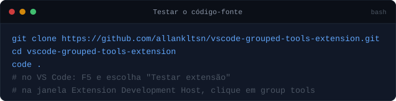
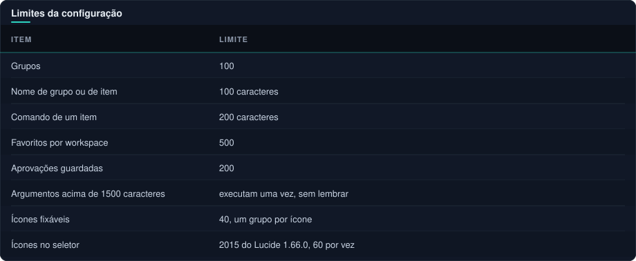
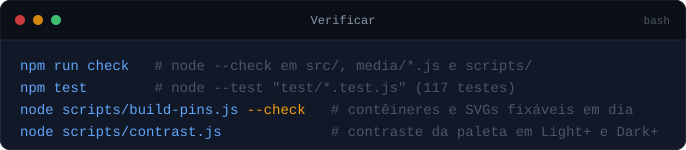
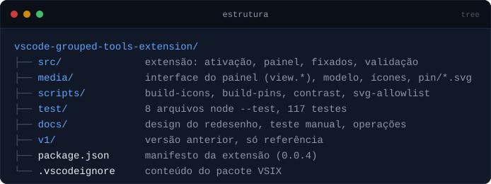

<picture>
  <source media="(prefers-color-scheme: dark)" srcset="assets/hero.svg">
  
</picture>

<p align="center">
  <a href="CHANGELOG.md"></a>&nbsp;
  <a href="docs/design/redesenho/teste-manual.md"></a>&nbsp;
  <a href="https://github.com/allankltsn/vscode-grouped-tools-extension/issues"></a>
</p>

<p align="center">
  
  
  
  
  
</p>

---

**Ferramentas agrupadas** é uma extensão do VS Code que reúne atalhos para os painéis de outras extensões em um painel compacto, com busca, grupos recolhíveis com cor e ícone, favoritos e modo Organizar (arrastar, renomear, cor, ícone). Um grupo pode ser fixado na barra de atividades e na barra de status. O painel segue as cores e fontes do tema (claro, escuro e alto contraste) e os favoritos ficam salvos por workspace.

Ela agrupa atalhos; não move as interfaces originais das extensões.

> [!NOTE]
> Esta versão ainda não foi verificada dentro de um VS Code real: os testes automáticos rodam em Node e a interface foi exercitada em um navegador headless. O roteiro para conferir à mão está em [docs/design/redesenho/teste-manual.md](docs/design/redesenho/teste-manual.md).

##  Início rápido



<details>
<summary>Copiar comandos</summary>

```bash
git clone https://github.com/allankltsn/vscode-grouped-tools-extension.git
cd vscode-grouped-tools-extension
code .
# no VS Code: F5 e escolha "Testar extensão"
# na janela Extension Development Host, clique em Ferramentas
```

</details>

Não há `npm install` nem build: é JavaScript puro, sem dependências. Se uma sessão de depuração antiga estiver aberta, encerre-a e inicie de novo.

**Instalar como VSIX.** O menu de três pontos de Extensões (Ctrl+Shift+X) oferece *Instalar do VSIX*, mas este repositório ainda não tem comando de empacotamento: o `@vscode/vsce` não está instalado nem aprovado aqui (política de instalações, [registro](docs/operations/registro-instalacoes.md)), por isso não há script no `package.json`. O `.vscodeignore` define o conteúdo do pacote: `package.json`, `README.md`, `src/**` e `media/**`, mais o `CHANGELOG.md`, que o `vsce` inclui por padrão; `assets/**` fica de fora.

> [!WARNING]
> Pendência conhecida, NÃO verificada: pelo conhecimento do `vsce`, ele recusa imagens SVG no README e no changelog, exceto de provedores de badge confiáveis (como o shields.io). Este README e o `CHANGELOG.md` usam SVG locais em `assets/`, então o primeiro `vsce package` pode falhar. Isso vem do conhecimento do `vsce` e não foi executado aqui. A decisão (por exemplo, versão do README sem SVG para o pacote) fica para quando o `vsce` for aprovado.

##  Recursos

<table>
  <tr>
    <td width="50%" valign="top">
      <h3> Busca e favoritos</h3>
      <p>Filtra por ferramenta, grupo ou ID de comando; estrelas guardam favoritos por workspace. <code>groupedTools.groups</code> <code>Tab/Enter</code></p>
    </td>
    <td width="50%" valign="top">
      <h3> Modo Organizar</h3>
      <p>Arraste itens e grupos, ou use o teclado (Espaço, setas, Esc). Renomear, cor e ícone no menu do grupo. <code>Alt+setas</code> <code>Ctrl+Z</code></p>
    </td>
  </tr>
  <tr>
    <td width="50%" valign="top">
      <h3> Grupos fixados</h3>
      <p>Um ícone na barra de atividades e um item <code>Nome (N)</code> na barra de status, com card nativo que abre cada extensão. <code>40 ícones</code></p>
    </td>
    <td width="50%" valign="top">
      <h3> Não agrupadas</h3>
      <p>Bandeja sempre visível com as extensões instaladas e seus ícones originais, sanitizados. Adicione a um grupo com um gesto. <code>Adicionar a…</code></p>
    </td>
  </tr>
  <tr>
    <td width="50%" valign="top">
      <h3> Segurança</h3>
      <p>Itens do projeto com argumentos pedem confirmação modal; pasta não confiável usa só a configuração global. <code>Workspace Trust</code></p>
    </td>
    <td width="50%" valign="top">
      <h3> Temas e acessibilidade</h3>
      <p>Cores do tema ativo, foco visível, navegação por teclado e estados vazios. Paleta de grupos g-1 a g-10 medida por contraste. <code>g-1..g-10</code></p>
    </td>
  </tr>
</table>

##  Como funciona



- **Uma configuração.** Os grupos vivem em `groupedTools.groups`, no escopo Global (padrão, vale para todos os projetos) ou em Este projeto (grava no workspace e prevalece; a primeira edição copia a global).
- **Validação antes de exibir.** `src/config.js` aplica os limites e remove caracteres de controle e bidi dos nomes.
- **Um painel, dois modos.** Usar e Organizar mostram a mesma lista; salvar é automático a cada gesto, com aviso Desfazer por 8 s.
- **Fixar é opcional e só no Global.** O ícone da barra de atividades é um arquivo estático, por isso só ícones do catálogo curado (`media/pin-catalog.js`, 40 ícones) podem ser fixados, um grupo por ícone.

##  Números

<table>
  <tr>
    <td width="55%" valign="top">
      
    </td>
    <td width="45%" valign="top">
      
    </td>
  </tr>
</table>

Contagens feitas no repositório em 04/11/2026: `npm test` roda 117 testes em 8 arquivos e todos passam; as linhas excluem `media/icons.js` (Lucide, gerado) e `media/pin/*.svg` (gerados). A extensão declara 41 contêineres na barra de atividades (1 principal e 40 fixáveis) e o seletor de ícones oferece 2015 ícones do Lucide 1.66.0.

##  Uso

- **Usar.** Clique num item para abrir o painel da extensão; a estrela favorita; a busca filtra grupos e itens; **Recolher todos** (Alt+Shift+C com o painel em foco) alterna entre recolher e expandir.
- **Organizar.** O botão abre o modo de edição sobre a mesma lista. Arraste pela alça, ou use Espaço (pegar), setas (mover; esquerda e direita trocam de grupo), Espaço (soltar) e Esc (cancelar); Alt+setas move um passo. O menu ⋯ oferece Mover para…, Renomear, Cor e ícone e Excluir; duplo clique no nome renomeia o grupo.
- **Ícones.** O seletor busca entre todos os ícones Lucide (nome, tags, palavras em português como banco, nuvem, pasta) e mostra 60 por vez. Ícones de grupos e itens aceitam qualquer nome do Lucide (ex.: `plus`, `music`, `kanban`).
- **Fixar.** ⋯ do grupo, **Fixar na barra de atividades e na barra de status** (só no escopo Global). Clicar no ícone ou no item abre o painel com os outros grupos recolhidos, rola até o grupo, destaca e foca; o ícone principal Ferramentas restaura o recolhimento anterior.
- **Grupo padrão.** O único é **Qualidade e testes** (cor Verde, classe `g-7`) com Problemas e Testes. O cartão de primeira vez oferece *Criar o grupo sugerido* ou *Começar do zero*. Os atalhos de extensões abrem o painel original (`workbench.view.extension.<id do contêiner>`) e só funcionam com a extensão instalada.

<details>
<summary><b>Posicionar o painel na barra lateral secundária</b></summary>

O VS Code não permite que uma extensão contribua diretamente à barra lateral secundária por padrão. Mova o painel uma vez:

1. Abra Ferramentas.
2. No menu de contexto do título Ferramentas, escolha *Mover Exibição* e *Barra Lateral Secundária* (os nomes podem variar conforme o idioma e a versão).
3. Também é possível arrastar a exibição para a barra lateral secundária.
4. Ajuste a largura para cerca de 300 px; a interface se adapta a outras larguras.
5. Para liberar espaço para código, use Exibir, Aparência, Barra Lateral Secundária para ocultar ou reabrir a barra.

O posicionamento é administrado pelo VS Code; após mover, o acesso ao painel acompanha a localização escolhida. Não há ícone espelhado nesta versão.

</details>

<details>
<summary><b>Detalhes do painel: bandeja, ícone, salvar e escopo</b></summary>

- **Não agrupadas:** sempre visível abaixo dos grupos (recolhível; o estado é lembrado). Uma linha por extensão; se ela tem vários painéis, aparece "N painéis" e *Adicionar a…* pergunta qual. Os ícones são os originais das extensões (ícone do contêiner na barra de atividades ou o PNG da extensão), lidos e sanitizados; o genérico aparece quando não há como mostrar o original com segurança. Comandos livres entram por ⋯, *Adicionar item…*, *Comando do VS Code*.
- **Lembrar de ocultar o ícone ao adicionar:** o VS Code não oferece como uma extensão ocultar o ícone de outra na barra de atividades. Com a opção marcada, o painel mostra o passo ("clique com o botão direito no ícone e escolha Ocultar") e o botão *Copiar passo*.
- **Onde fica o ícone Ferramentas:** o VS Code coloca novos ícones no fim da barra de atividades e a extensão não controla a posição. Na primeira ativação o painel abre sozinho e avisa; arraste o ícone para onde quiser.
- **Salvar:** automático a cada gesto, com aviso Desfazer por 8 s (Ctrl+Z também). Erros mantêm o rascunho na tela, com *Tentar de novo* ou *Descartar*.
- **Escopo:** Global (padrão) vale para todos os projetos; Este projeto grava no workspace e prevalece. Em pasta não confiável (Workspace Trust) só vale o Global e Este projeto fica indisponível. Edições avançadas (argumentos de comando) ficam no Settings (`groupedTools.groups`).

</details>

##  Segurança

> [!WARNING]
> Itens do escopo **Global** (e os grupos fixados) executam qualquer comando sem confirmação, inclusive `runCommands`, porque essa configuração é do próprio usuário. Não cole configuração de terceiros no Global sem ler.

- **Itens do projeto.** A configuração do projeto (`.vscode/settings.json`) pode vir de um repositório de terceiros. No escopo Este projeto, um item com argumentos, ou com comando fora de `workbench.view.*` e de uma lista curta de ações inofensivas (`SAFE_ACTIONS` em `src/tools-view.js`), pede confirmação modal com o comando e os argumentos completos; caracteres ocultos aparecem escapados. Argumentos acima de 1500 caracteres só executam uma vez; nos demais há *Executar e lembrar* (guardado como SHA-256 no `workspaceState`).
- **Pasta não confiável.** A extensão declara suporte limitado (`untrustedWorkspaces`, `restrictedConfigurations: groupedTools.groups`) e lê e grava só o valor Global enquanto a pasta não for confiável.
- **Comandos bloqueados como item:** `groupedTools.run`, `runById`, `openGroup` e `manageGroup`.
- **Ícones.** `media/icons.js` e `media/pin/*.svg` só podem conter as tags e atributos da lista em `scripts/svg-allowlist.js`; o gerador e um teste falham se aparecer outra coisa. Os ícones de extensões de terceiros passam por sanitização antes de chegar ao painel.



<details>
<summary>Copiar limites como texto</summary>

| Item | Limite |
|---|---|
| Grupos | 100 |
| Nome de grupo ou de item | 100 caracteres |
| Comando de um item | 200 caracteres |
| Favoritos por workspace | 500 |
| Aprovações guardadas | 200 |
| Argumentos acima de 1500 caracteres | executam uma vez, sem lembrar |
| Ícones fixáveis | 40, um grupo por ícone |
| Ícones no seletor | 2015 do Lucide 1.66.0, 60 por vez |

</details>

<details>
<summary>Mais regras de segurança</summary>

- **Aprovações antigas:** aprovações gravadas em texto puro por versões anteriores deixam de valer; o modal pede confirmação mais uma vez e passa a guardar só o hash. Na ativação, favoritos antigos viram hash quando o item ainda existe. Espaços repetidos nos argumentos aparecem como `␠×N` no modal.
- **Ações que gravam em `settings.json`** (como alternar a barra de status ou a de atividades) não fazem parte da lista de ações sem confirmação no projeto.
- **Ids:** o id de um grupo sem `id` na configuração é derivado do nome (`grp-<hash do nome>`); renomear um grupo escrito à mão (sem id) muda o id até o painel gravá-lo. O id de item deriva de comando, nome e argumentos.
- **Contraste:** `node scripts/contrast.js` mede a paleta (barra 3:1, texto 4.5:1) em Light+ e Dark+.
- **Limites da plataforma nos fixados:** o hover da barra de atividades mostra só o título "Ferramentas · <ícone>" (não o nome nem a cor do grupo); o excedente da barra de status é cortado pelo VS Code. Os contêineres, views e SVGs são gerados: `node scripts/build-pins.js` (`--check` verifica; o teste compara).

</details>

##  Verificação



<details>
<summary>Copiar comandos</summary>

```bash
npm run check   # node --check em src/, media/*.js (exceto icons.js) e scripts/
npm test        # node --test "test/*.test.js" (117 testes)
node scripts/build-pins.js --check   # contêineres e SVGs fixáveis em dia
node scripts/contrast.js             # contraste da paleta em Light+ e Dark+
```

</details>

`npm run check` e `npm test` exigem Node.js 21 ou superior: o check usa `fs.readdirSync` recursivo e o test usa um glob entre aspas, expandido pelo próprio Node. Os testes cobrem configuração, comandos, provedor (com mock do `vscode`), pins, ícones de extensões, endurecimento de segurança e o modelo do painel. O teste manual no VS Code segue [docs/design/redesenho/teste-manual.md](docs/design/redesenho/teste-manual.md).

##  Estrutura



<details>
<summary>Copiar árvore e arquivos principais</summary>

```text
vscode-grouped-tools-extension/
├── src/              extensão: ativação, painel, fixados, validação
├── media/            interface do painel (view.*), modelo, ícones, pin/*.svg
├── scripts/          build-icons, build-pins, contrast, svg-allowlist
├── test/             8 arquivos node --test, 117 testes
├── docs/             design do redesenho, teste manual, operações
├── v1/               versão anterior, só referência
├── assets/           imagens do README e do CHANGELOG, fora do VSIX
├── package.json      manifesto da extensão (0.0.4)
└── .vscodeignore     conteúdo do pacote VSIX
```

- `src/extension.js`: ativação, comandos, contêineres fixos. `src/tools-view.js`: provedor do painel, mensagens, escopos, `focusGroup`.
- `src/pins.js`: context keys, itens da barra de status e tooltip Markdown; redirecionador das views fixas. `src/config.js` e `src/commands.js`: módulos puros. `src/ext-icons.js`: ícones originais das extensões.
- `media/`: `view.html`, `view.css`, `view.js` (interface), `model.js` (modelo puro), `sync.js`, `svg-safe.js`, `pin-catalog.js` (catálogo único dos ícones fixáveis), `icons.js` (Lucide, gerado), `pin/*.svg` (gerados).

</details>

##  Contribuir e licença

O fluxo de branches é gitflow: `main` recebe releases, `develop` integra, e `feature/*` parte de `develop` e volta para ele. Mudanças passam por `npm run check` e `npm test` antes de seguir. O histórico das versões está no [CHANGELOG](CHANGELOG.md).

**Licença:** ainda não definida. O repositório não tem arquivo `LICENSE` e o `package.json` não declara `license`. Os ícones são do [Lucide](https://lucide.dev) (ISC, texto em `media/lucide-LICENSE.txt`).
